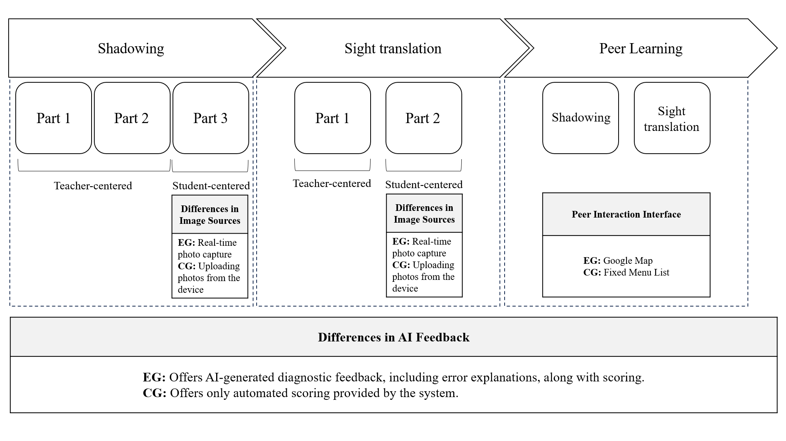
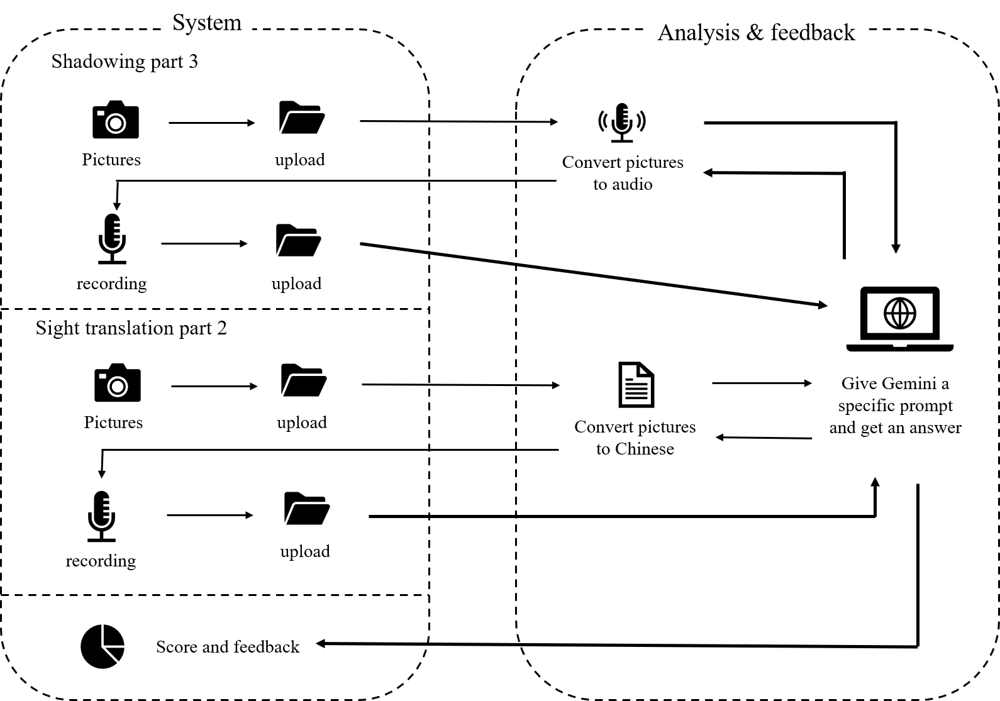

# InterpretingGAI：結合真實情境與 AI 回饋之口譯學習系統促進 EFL 英語口說學習

## 專案簡介
本專案為國立東華大學資訊工程學系碩士論文之實作系統，本研究設計並開發了一套能應用於真實情境中的口譯巧練習系統—— InterpretingGAI，旨在透過真實情境與生成式 AI 技術輔助 EFL 學習者進行口譯與英語口說訓練。系統整合了兩項主要的口譯訓練技巧：
shadowing（跟讀）與 sight translation（視譯）。系統已完成為期 10 週、共 96 位學習者參與之教學實證研究。

## 核心功能與技術亮點
* **雙模式口譯訓練**：
  * **Shadowing（跟讀訓練）**：是一種語言學習與口譯訓練中常用的技巧。學習者在聽到語音的當下，幾乎同步地跟著大聲朗讀，模仿說話者的 發音、語速、語調。
  * **Sight Translation（視譯訓練）**：是一種結合口譯與筆譯能力的技巧。口譯員在看到一份書面文本的同時，需要即時將其口語化為另一種語言，強調快速閱讀理解與口說表達的同步進行。

* **多模態 AI 即時回饋（Gemini API）**：串接 Google Gemini API，針對學習者語音與練習內容提供分數評量、發音診斷與語句修正提示。
* **GPS 情境式同儕觀摩（Google Maps SDK）**：結合地理位置設計，讓學習者能瀏覽並觀摩同儕在不同地點的練習紀錄，促進互動與自我調整學習。

## 技術架構 (Tech Stack)
* **Frontend**: HTML5, CSS3, JavaScript (ES6+), Google Maps JavaScript SDK
* **Backend & AI**: Python, PHP, Google Gemini API (Multimodal)
* **Database & Infrastructure**: MySQL / MariaDB, Docker

## 系統架構與設計流程

### 1. 系統設計概念與功能模組

* **三階段學習模組**：涵蓋跟讀（Shadowing）、視譯（Sight Translation）與同儕觀摩（Peer Learning），支援教師引導與學生自主之真實情境兩種模式。
* **地圖式同儕互動**：相較於僅提供靜態選單的對照組，實驗組整合 Google Maps 介面作為同儕學習入口，取代傳統靜態選單，讓學生可以直接在地圖上點擊不同地點，觀看和學習其他同學在不同地點的練習紀錄。
* **差異化 AI 回饋機制**：相較於僅提供基礎評分的對照組，實驗組系統串接生成式 AI 提供即時語音診斷與錯誤修正建議。

### 2. 多模態任務流程與 AI 回饋機制

* **多模態情境轉換管線**：前端上傳真實情境照片後，後端依任務類型自動將圖片轉為練習音檔（Shadowing）或中文視譯文本（Sight Translation）。
* **自動化語音評測與 Prompt 工程**：接收學習者錄音檔後，透過結構化 Prompt 呼叫 Gemini API 進行多維度語義與發音分析，並即時回傳評分與個人化學習建議。
